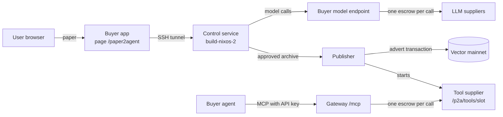

# Paper2Agent: how it works and current state

State recorded on 2026-10-15 at 07:30 UTC. Updated at 08:15 UTC after the buyer wallet repair.
For the full design, limits, and payment rules, see [PAPER2AGENT_PLAN.md](PAPER2AGENT_PLAN.md).

## Summary

Paper2Agent converts a research paper into a paid MCP tool on the Vector marketplace.

1. A user submits a paper on the buyer page `https://marketplace.vector.apexfusion.org/paper2agent`.
2. A coding agent writes a Python MCP tool for one method from the paper.
3. A separate verifier agent checks the tool against the paper.
4. A person reviews the result and approves it.
5. The publisher puts an advert for the tool on chain and starts a supplier for it.
6. Buyer agents call the tool through the gateway MCP endpoint. They pay for each call through escrow.

Each model call of the coding and verifier agents is also a marketplace purchase.
The shared buyer wallet pays for these calls.

## Architecture



| Component | Location | Role |
|---|---|---|
| Buyer app | Production host `91.98.147.172`, `https://marketplace.vector.apexfusion.org` | Submission, progress, review, and publication page. Proxy for `/v1/paper2agent/*`. Paid model endpoint for builds. |
| Control service | `build-nixos-2` (`144.76.217.30`), rootless Docker | Job database (SQLite). Build queue that runs one build at a time. Offline build and verifier containers. |
| Publisher | Production host | Six wallet slots. Runtime images, advert transactions, and one managed supplier for each published tool. |
| Gateway | Production host, `https://api.marketplace.vector.apexfusion.org/mcp` | MCP access for buyer agents. Spending approval, escrow, receipt checks, and recovery. |
| Indexer | Production host | Adverts and supplier status. It reads each supplier status about every 20 s. |

## From paper to published tool

1. **Submit** (job state `queued`).
   The user gives an HTTPS URL, pasted text, or a PDF of at most 5 MiB and 200 pages.
   The control service keeps the paper bytes and their SHA-256. Attempt 1 starts immediately.
2. **Build** (`building`).
   The coding agent works in an offline, unprivileged Docker container.
   It can read and write files, run commands, and install pinned Python wheels.
   It receives at most 60,000 bytes of paper text.
   It writes `server.py`: one FastMCP 4.0.11 tool with a JSON object as input and output, on stdio.
3. **Verify** (`verifying`).
   A new agent session receives the paper and the frozen package.
   It makes reference outputs from the paper, not from the implementation.
   The control service runs the checks and replays each reference case through real MCP in a new container.
   A failed check gives no artifact.
4. **Review** (`awaiting_review`, then `approved` or `rejected`).
   The page shows the check output, the source, the manifest, the licenses, and the hashes. It also gives a ZIP download.
   Approval binds the archive SHA-256 and three attestations: code, license and data rights, and results.
5. **Prepare** (publication `prepared`).
   The publisher checks the archive and builds the runtime image offline. It sends no transaction.
6. **Publish** (publication `published`).
   The operator sets a maximum wallet debit.
   The publisher signs the advert, records it, and sends it one time.
   After confirmation, the publisher starts the tool supplier on `/p2a/tools/<slot>`.

A failed attempt goes to `failed`. Only an operator can start a new attempt.
A control service restart sets a running build to `interrupted`. It does not start the spending again.
An unknown publish result goes to `confirmation_pending`. The publisher never signs a second advert for it.

## Build model calls

- The control service sends OpenAI Chat Completions requests with model `auto` to `https://api.marketplace.vector.apexfusion.org/v1/paper2agent/model/chat/completions`.
  This host connects directly to Traefik.
  Do not use the Cloudflare host `marketplace.vector.apexfusion.org`: Cloudflare stops responses after 100 s (HTTP 524), but the buyer still pays.
- The buyer app buys each call as one marketplace escrow from the buyer wallet (Post, Claim, Submit, Accept).
  One call runs at a time.
  A call costs about 3 AP3X (measured: 3.003256 AP3X for a 0.2 AP3X price and 1 AP3X bonds).
- `auto` chooses from all Active `llm.text.generate.v1` adverts with at least 4096 output tokens, except the models in the buyer's `PAPER2AGENT_MODEL_AUTO_EXCLUDE`:
  - Suppliers that the indexer shows as free come first. Then the lowest price comes first. Equal prices are in random order.
  - The live `/status` of the supplier must be `free`.
  - The buyer app skips a supplier whose `/capability` refuses Responses requests with tools. This occurs before payment.
  - The buyer app skips a supplier for 15 minutes after a paid call to it fails. It keeps this list in memory only.
- A build has no call, token, or time limit. The buyer wallet is the only limit.
  If the wallet cannot pay, the endpoint answers HTTP 402 before any transaction.
  The build then pauses and sends the same call again every 60 s.
- The build sends a failed call again after 60 s. It sends a reply without a tool call again immediately.
  Three such results with no good reply between them end the attempt.
- Node `fetch` stops a call when the response headers take more than 300 s.

## Paid calls to a published tool

- Endpoint: `https://api.marketplace.vector.apexfusion.org/mcp`.
  The tool name is `p2a_<tool name>_<first 16 hex characters of the manifest hash>`.
  The advert has the capability `mcp.tool.execute.v1` and the model `paper2agent:<manifest hash>`.
- Any API key can list the tools.
  A paid call needs a dedicated, unused key that an operator approves (`gateway/src/cli/paper2agent-approval.ts`).
  The approval sets the manifest hash, the supplier, the maximum price, the maximum total spend, and the maximum number of calls.
- One call is one escrow.
  The tool supplier runs the tool in an offline container and signs a receipt.
  The gateway checks the receipt and sends Accept.
  After a lost response, recovery reads the existing job. It does not buy a second call.
- Limits: JSON object input of at most 64 KiB, output of at most 256 KiB, and run time of at most 120 s. The advert SLA is 390 s.
- Measured cost: 3.003256 AP3X for one call of a tool with a 0.2 AP3X price and 1 AP3X bonds.
  Accept pays the supplier at least 2 AP3X because of the minimum UTxO value.

## Current state (2026-10-15)

### Services

| Service | Version | Running since (UTC) | Status |
|---|---|---|---|
| Buyer app | commit `e847a55`, image `a1f525ba` | 2026-10-13 09:57 | healthy |
| Control service | commit `61b20af`, image `84d0b72e`, `PAPER2AGENT_MODEL=auto` | 2026-10-13 09:58 | `build_ready: true` |
| Publisher | image `3b378beb` | 2026-10-13 | `publisher_ready: true` |
| Gateway | — | 2026-10-12 11:16 | healthy |

Both hosts use the runtime base image `sha256:d9b9ddd03b60157362426ceb437fb1d43425a1f7463d86968a55ed997e995009`.
The production checkout is at `49e3b03`.
That commit adds only `papers/Replicating-SwarmWorld-with-open-weight-models.pdf` (4.2 MB). No job uses this paper.

### Jobs

| Job | ID | Attempts | State | Result |
|---|---|---|---|---|
| paper2agent-giou-smoke | `ee7202fa` | 3 | `approved`, published | `calculate_giou` on slot `paper-tool-2` |
| ConsistentHashAlgo | `76b3e9df` | 1 | `approved`, published | `assign_buckets` on slot `paper-tool-1` |
| ConsistendHashAlgoV2 | `091194bd` | 6 | `building` | No artifact yet |

ConsistendHashAlgoV2 history (UTC):

- 2026-10-13: attempts 1 and 2 (09:33, 09:40) used only `gpt-5.6-sol`. They failed with HTTP 503, because the indexer still showed the one supplier as busy.
- 2026-10-13: attempt 3 (09:49) failed after a Cloudflare HTTP 524 and two supplier failures.
- 2026-10-13: attempt 4 (09:58) made more than 24 model calls. It failed at 10:52 after three supplier HTTP 502 errors in a row.
- 2026-10-13: attempt 5 (11:12) paused at model call 11 at 11:27, because the buyer wallet had no collateral UTxO. The operator cancelled it on 2026-10-15 at 08:04.
- 2026-10-15: attempt 6 started at 08:08. By 08:12 it made 3 paid model calls (deepseek/deepseek-v4-flash, Qwen/Qwen3.6-35B-A3B-FP8, gpt-5.6-sol). Two more calls failed at `swarm-qwen38-27b-gptq4` suppliers (HTTP 502 and 504).

### Published tools

| MCP tool | Slot | Price | Buyer / supplier bond | Advert transaction | Paid calls |
|---|---|---|---|---|---|
| `p2a_assign_buckets_bd67d5a658a13610` | `paper-tool-1` | 0.2 AP3X | 1 / 1 AP3X | `411df8b63ec404c1…` | 2 settled, 4 refused before payment |
| `p2a_calculate_giou_7c99729a818f3148` | `paper-tool-2` | 1 AP3X | 2 / 2 AP3X | `35c0e780f001ddb6…` | 0 |

- Both adverts are Active, and the indexer shows both suppliers as free.
- Each publication cost its slot wallet 2.682488 AP3X.
- The gateway has one approved key, for `assign_buckets`. It used 2 of 5 calls and 6.006512 of 20 AP3X.
- The 4 refused calls failed with `paper2agent_insufficient_funds` and cost nothing.

### Wallets

| Wallet | Address | Balance (AP3X) | UTxOs |
|---|---|---|---|
| Buyer (pays build model calls) | `addr1vye6p9pau98dspuk0mu85htah6x9k2caz94fssshdhj777gta0gpx` | 584.53 (08:08, before attempt 6) | 26, largest 527.52 AP3X |
| `paper-tool-1` (published) | `addr1vy78w47xjc9mjqxucg0aguslpdgakf3tvwzlkuv2pl6cndgvk27hx` | 214.31 | 4 |
| `paper-tool-2` (published) | `addr1vytv6mwyeun07qmgg49q0zhmxhz59qn0ym00k2xtg94dt5spa8572` | 97.32 | 1 |
| `paper-tool-3` (free) | `addr1v86wzs8azj64heh7y9slcd9fvz60vma0cprae0fpwu9cu7c2dewht` | 100 | 1 |
| `paper-tool-4` (free) | `addr1vx36s8tpwd82x4y290pyjux5a5tfqrw52wq39pv0x5w9g2qjez9jm` | 100 | 1 |
| `paper-tool-5` (free) | `addr1vy53jeuvplmk4lvz7kegkeysqmmqs397u59394w7425fajq7mmw7u` | 100 | 1 |
| `paper-tool-6` (free) | `addr1vxu2qc7k8h7vr7j628l630cgz76w3rjq6am049s38p4drqqrvg66t` | 100 | 1 |

All UTxOs hold only AP3X.

### Build model calls with `auto` (2026-10-13 09:49–11:27 UTC)

| Model | Successful paid calls |
|---|---|
| deepseek/deepseek-v4-flash | 32 |
| Qwen/Qwen3.6-35B-A3B-FP8 | 6 |
| gpt-5.6-sol | 6 |
| Qwen3.8-27B | 3 |
| moonshotai/kimi-k2.6 | 2 |
| deepseek-v4-pro | 1 |

The 50 successful calls cost about 150 AP3X (estimate: 50 × 3 AP3X).
23 more paid calls failed at the supplier (see problem 4). Their escrows were reclaimed on 2026-10-15 (see [Buyer wallet repair](#buyer-wallet-repair-2026-10-15)).

## Buyer wallet repair (2026-10-15)

| Time (UTC) | Action | Result |
|---|---|---|
| 08:04 | Cancelled attempt 5 | It was paused and spent nothing. A running build would use the same wallet inputs as the Reclaims. |
| 08:05 | Consolidated the wallet | Transaction `5dd99f9f9f2ae2a03572d169ca1ab31e3a29023deb256c3eb99dc8e652d48069`: 248 inputs, 9,199 bytes, fee 0.591836 AP3X. Outputs: 5 AP3X collateral, 539.04 AP3X working, 1.41 AP3X change. |
| 08:05–08:08 | Ran `reclaim-orphans.ts` | 23 Reclaims confirmed. They returned 50.62 AP3X for 11.54 AP3X in fees. The other 1,002 index rows were already spent and sent no transaction. |
| 08:08 | Started attempt 6 | The build makes paid model calls again. |

The buyer wallet went from 546.04 AP3X to 584.53 AP3X (+38.49 AP3X net).
At 08:08 UTC no expired buyer escrow was locked.
The two failed calls of attempt 6 (08:08 and 08:11) locked two new escrows (see problem 3).

## Open problems

### 1. The buyer wallet fragments again over time

- The buyer app has no wallet health check. Suppliers and the gateway run one.
- Probable cause (not confirmed): each Accept returns the buyer bond as a separate output of about 2 AP3X, and nothing combines the outputs.
- When no pure-AP3X UTxO of at least 5 AP3X is left, Accept has no collateral. The model endpoint then refuses every call with HTTP 402, and the build pauses.
- The pause message asks for a deposit, but the balance is sufficient; the UTxO shape is the problem.
- On 2026-10-15 the wallet held 546 AP3X in 248 UTxOs of at most 4 AP3X each. Attempt 5 waited 44 hours.
- Permanent fix: run the wallet health check in the buyer app, as the suppliers do.

### 2. `tx:consolidate-wallet` underprices large transactions

- The builder uses lucid's preset Cardano fee parameters (`minFeeA` 44, `minFeeB` 155381) and a 0.5 AP3X fee floor. Vector needs 45 and 156253.
- Above 7,638 bytes (about 200 inputs), the fee that Vector needs is more than the floor.
- For the 248-input wallet, the builder set a fee of 501,628 lovelace. Vector needs 570,208 lovelace for its 9,199 bytes, so the node rejects the transaction. No funds move.
- On 2026-10-15 a one-off script ran the same builder steps, with a fee floor from the live parameters and the signed size.
- Fix: compute the fee floor from the live parameters, or limit the number of inputs in each transaction.

### 3. Nothing reclaims the escrows of failed calls

- Production has no cron job or timer for `buyer/src/cli/reclaim-orphans.ts`.
- Each failed paid call locks its escrow (about 2.2 AP3X) until somebody runs the CLI after the deadline.
- A Reclaim costs about 0.5 AP3X. It returns about 1.7 AP3X net for an escrow with a 0.2 AP3X price and 1 AP3X bonds.
- The CLI also checks about 1,000 index rows that are already spent. One run took 2.5 minutes.
- Do not run it during a build: Reclaims and build calls can select the same wallet inputs.

### 4. Some suppliers in the `auto` pool fail often

| Supplier model | Failed paid calls (2026-10-13) |
|---|---|
| swarm-qwen38-27b-gptq4 (4 endpoints) | 14 |
| meta-llama/Llama-3.3-70B-Instruct | 3 |
| deepseek-v4-pro | 2 |
| Qwen3.8-27B | 2 |
| moonshotai/kimi-k2.6 | 1 |
| deepseek/deepseek-v4-flash | 1 |

- Seen causes: swarm-qwen38 upstream HTTP 502 and 504; Llama-3.3 upstream HTTP 402 ("You have no remaining …"); one Qwen3.8-27B call took more than 300 s.
- `swarm-qwen38-27b-gptq4` has 5 adverts and no successful build call. Attempt 6 had two more failures with it in its first four minutes.
- Each failure costs a Post fee and locks an escrow until a Reclaim (see problem 3).
- The 15-minute skip list covers one endpoint, and it is lost when the buyer app restarts.
- Options: repair or retire these adverts, or add an exclude list to `auto`.

### 5. Model quality varies

- Most adverts cost 0.2 AP3X, so `auto` chooses mostly at random.
- deepseek/deepseek-v4-flash has 9 adverts, more than any other model. It got 32 of the 50 calls on 2026-10-13.
- One build can use several models.
- To use one model only, set `PAPER2AGENT_MODEL=<model>` in `.env.control` and restart the control service.

### 6. Network failures during a pause count toward the failure limit

- HTTP 402 refusals do not reset the count of failed calls.
- A network failure during a long pause still counts. Three failures in a row end the attempt.
- Attempt 5 had one such failure (2026-10-14 06:06 UTC).

### 7. Open access

- The buyer app has no password.
- Anyone can submit papers. The buyer wallet pays for their builds.
- Anyone can approve artifacts and publish them to the four free slots. Each publication costs a slot about 2.7 AP3X.

### 8. Manual releases

- A push to `main` does not update the control service or the publisher.
- Release them by hand. See [DEPLOY_NEW_SUPPLIER.md](DEPLOY_NEW_SUPPLIER.md).

## Operations reference

| Task | Command or location |
|---|---|
| Service status | `curl -s https://marketplace.vector.apexfusion.org/v1/paper2agent/status` |
| Jobs and one job | `GET /v1/paper2agent/jobs`, `GET /v1/paper2agent/jobs/<id>` |
| Build log | `GET /v1/paper2agent/jobs/<id>/events?after=<seq>` (100 events for each page) |
| Wallet slots | `GET /v1/paper2agent/targets` |
| New build attempt | `POST /v1/paper2agent/jobs/<id>/build` with the header `X-Paper2Agent-Request: 1` and the body `{"confirm":true}` |
| Model call log | Production host: `docker logs marketplace-mainnet-buyer 2>&1 \| grep paper2agent-model` |
| Control settings | `build-nixos-2`: `/var/lib/paper2agent-build/release/paper2agent/.env.control` |

Wallet commands on the production host. The buyer key stays in the container.
Do not run them while a build makes model calls, because they spend the same wallet inputs.

```sh
# Reclaim every expired Open or Claimed escrow of the buyer wallet.
docker exec marketplace-mainnet-buyer sh -c 'env | grep -E "^(BUYER_PRIV_KEY_HEX|OGMIOS_URL|INDEXER_URL|NETWORK_ID|VECTOR_ZERO_TIME_MS)=" | node --import tsx buyer/src/cli/reclaim-orphans.ts --env /dev/stdin'

# Consolidate the buyer wallet. Use it only below about 200 UTxOs (see problem 2).
docker exec marketplace-mainnet-buyer node --import tsx buyer/src/cli/consolidate-wallet.ts
```

Related documents:

- [PAPER2AGENT_PLAN.md](PAPER2AGENT_PLAN.md): design, limits, payment and recovery rules, verification record.
- [DEPLOY_NEW_SUPPLIER.md](DEPLOY_NEW_SUPPLIER.md): control service and publisher deployment, wallet slots.
- [gateway.md](gateway.md#paper2agent-tools): key approval, MCP access, and job recovery.
