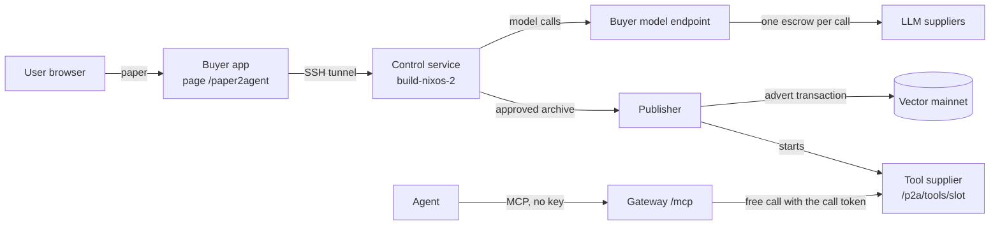

# Paper2Agent: how it works and current state

State recorded on 2026-10-15 at 07:30 UTC. Updated on 2026-10-16 at 10:45 UTC after the release of free MCP calls and faster builds (`90b7a56`) and build attempt 8.
For the full design, limits, and payment rules, see [PAPER2AGENT_PLAN.md](PAPER2AGENT_PLAN.md).

## Summary

Paper2Agent converts a research paper into a free MCP tool on the Vector marketplace.

1. A user submits a paper on the buyer page `https://marketplace.vector.apexfusion.org/paper2agent`.
2. A coding agent writes a Python MCP tool for one method from the paper.
3. A separate verifier agent checks the tool against the paper.
4. A person reviews the result and approves it.
5. The publisher puts an advert for the tool on chain and starts a supplier for it.
6. Agents call the tool through the public gateway MCP endpoint. A call needs no API key and no payment.

Each model call of the coding and verifier agents is also a marketplace purchase.
The shared buyer wallet pays for these calls.

## Architecture



| Component | Location | Role |
|---|---|---|
| Buyer app | Production host `91.98.147.172`, `https://marketplace.vector.apexfusion.org` | Submission, progress, review, and publication page. Proxy for `/v1/paper2agent/*`. Paid model endpoint for builds. |
| Control service | `build-nixos-2` (`144.76.217.30`), rootless Docker | Job database (SQLite). Build queue that runs one build at a time. Offline build and verifier containers. |
| Publisher | Production host | Six wallet slots. Runtime images, advert transactions, and one managed supplier for each published tool. |
| Gateway | Production host, `https://api.marketplace.vector.apexfusion.org/mcp` | Public MCP access for agents. Free tool calls with limits for each client IP. No API key. |
| Indexer | Production host | Adverts and supplier status. It reads each supplier status about every 20 s. |

## From paper to published tool

1. **Submit** (job state `queued`).
   The user gives an HTTPS URL, pasted text, or a PDF of at most 5 MiB and 200 pages.
   The control service keeps the paper bytes and their SHA-256. Attempt 1 starts immediately.
2. **Build** (`building`).
   The coding agent works in an offline, unprivileged Docker container.
   It can read and write files, run commands, and install pinned Python wheels.
   It receives at most 60,000 bytes of paper text.
   It writes `server.py`: one FastMCP 4.0.11 tool with a JSON object as input and output, on stdio.
3. **Verify** (`verifying`).
   A new agent session receives the paper and the frozen package.
   It makes reference outputs from the paper, not from the implementation.
   When the verifier finishes, the control service runs the checks and replays each reference case through real MCP in a new container.
   If a check fails, the verifier gets the error and can repair `check.py` or `cases.json`. It can do this up to 2 times.
   The next failure ends the attempt. A failed check gives no artifact.
4. **Review** (`awaiting_review`, then `approved` or `rejected`).
   The page shows the check output, the source, the manifest, the licenses, and the hashes. It also gives a ZIP download.
   Approval binds the archive SHA-256 and three attestations: code, license and data rights, and results.
5. **Prepare** (publication `prepared`).
   The publisher checks the archive and builds the runtime image offline. It sends no transaction.
6. **Publish** (publication `published`).
   The operator sets a maximum wallet debit.
   The publisher signs the advert, records it, and sends it one time.
   After confirmation, the publisher starts the tool supplier on `/p2a/tools/<slot>`.

A failed attempt goes to `failed`. Only an operator can start a new attempt.
A control service restart sets a running build to `interrupted`. It does not start the spending again.
An unknown publish result goes to `confirmation_pending`. The publisher never signs a second advert for it.

## Build model calls

- The control service sends OpenAI Chat Completions requests with model `auto` to `https://api.marketplace.vector.apexfusion.org/v1/paper2agent/model/chat/completions`.
  This host connects directly to Traefik.
  Do not use the Cloudflare host `marketplace.vector.apexfusion.org`: Cloudflare stops responses after 100 s (HTTP 524), but the buyer still pays.
- The buyer app buys each call as one marketplace escrow from the buyer wallet (Post, Claim, Submit, Accept).
  It posts one escrow at a time, and it does not send a second call to a supplier that has an open call.
  The answer returns after Submit. The Accept transaction runs in the background (up to 3 attempts, 10 s apart).
  The next Post does not spend the wallet outputs of an Accept that is not confirmed.
  If the other outputs cannot pay, the next call waits for the pending Accepts.
  The buyer app checks for a confirmation every 0.5 s.
  A call costs about 3 AP3X (measured: 3.003256 AP3X for a 0.2 AP3X price and 1 AP3X bonds).
- `auto` chooses from all Active `llm.text.generate.v1` adverts with at least 4096 output tokens, except the models in the buyer's `PAPER2AGENT_MODEL_AUTO_EXCLUDE`:
  - Suppliers that the indexer shows as free come first. Then the lowest price comes first. Equal prices are in random order.
  - The live `/status` of the supplier must be `free`.
  - The buyer app skips a supplier whose `/capability` refuses Responses requests with tools. This occurs before payment.
  - The buyer app skips a supplier for 15 minutes after a paid call to it fails. It keeps this list in memory only.
- A build has no call, token, or time limit. The buyer wallet is the only limit.
  If the wallet cannot pay, the endpoint answers HTTP 402 before any transaction.
  The build then pauses and sends the same call again every 60 s.
- After a failed call, the build waits 10 s × the number of failures in sequence, then sends the call again.
  It sends a reply without a tool call again immediately.
  Three such results with no good reply between them end the attempt.
- Node `fetch` stops a call when the response headers take more than 300 s.

## Calls to a published tool

- Endpoint: `https://api.marketplace.vector.apexfusion.org/mcp`. It needs no API key and no payment.
  The tool name is `p2a_<tool name>_<first 16 hex characters of the manifest hash>`.
  The advert has the capability `mcp.tool.execute.v1` and the model `paper2agent:<manifest hash>`.
- `tools/list` also shows a busy tool. The gateway caches the list for 30 s.
- `tools/call` is free. The gateway sends the call to the publisher with `PAPER2AGENT_TOOL_CALL_TOKEN`.
  The tool supplier runs the tool in a new offline container. There is no escrow and no receipt.
- The gateway lists only tools whose advert endpoint is under `PAPER2AGENT_PUBLISHER_PUBLIC_URL/tools/`.
  The call token never goes to another host.
- Gateway limits: 120 `/mcp` requests and 20 calls per minute for each client IP, 1 call in progress for each IP,
  1 call for each tool supplier, and 2 calls in total. Other calls wait for at most 60 s, then the call reports busy.
- Limits: JSON object input of at most 64 KiB, output of at most 256 KiB, and run time of at most 120 s.
- A direct on-chain buyer can still pay the tool supplier through escrow with the Node SDK. The advert SLA is 390 s.
  One paid call cost 3.003256 AP3X for a tool with a 0.2 AP3X price and 1 AP3X bonds.

## Current state (2026-10-16)

### Services

| Service | Version | Running since (UTC) | Status |
|---|---|---|---|
| Buyer app | commit `90b7a56`, image `7f8cd70c`, `PAPER2AGENT_MODEL_AUTO_EXCLUDE=swarm-qwen38-27b-gptq4` | 2026-10-16 09:57 | healthy |
| Control service | commit `90b7a56`, image `ed9e91f9`, `PAPER2AGENT_MODEL=auto` | 2026-10-16 10:01 | `build_ready: true` |
| Publisher | commit `90b7a56`, image `ed9e91f9` | 2026-10-16 09:56 | `publisher_ready: true` |
| Gateway | commit `90b7a56`, image `6111ffe4`, free `/mcp` | 2026-10-16 09:56 | healthy |

Both hosts use the runtime base image `sha256:d9b9ddd03b60157362426ceb437fb1d43425a1f7463d86968a55ed997e995009`.
The production checkout follows `main`.
Rollback images: buyer and gateway `rollback-e4eedad`, publisher `rollback-3b378beb`, control `rollback-84d0b72e`.

### Jobs

| Job | ID | Attempts | State | Result |
|---|---|---|---|---|
| paper2agent-giou-smoke | `ee7202fa` | 3 | `approved`, published | `calculate_giou` on slot `paper-tool-2` |
| ConsistentHashAlgo | `76b3e9df` | 1 | `approved`, published | `assign_buckets` on slot `paper-tool-1` |
| ConsistendHashAlgoV2 | `091194bd` | 8 | `awaiting_review` | Artifact `de921ef0c2717a3c…`, tool `binomial_hash`. Not reviewed or published. |

ConsistendHashAlgoV2 history (UTC):

- 2026-10-13: attempts 1 and 2 (09:33, 09:40) used only `gpt-5.6-sol`. They failed with HTTP 503, because the indexer still showed the one supplier as busy.
- 2026-10-13: attempt 3 (09:49) failed after a Cloudflare HTTP 524 and two supplier failures.
- 2026-10-13: attempt 4 (09:58) made more than 24 model calls. It failed at 10:52 after three supplier HTTP 502 errors in a row.
- 2026-10-13: attempt 5 (11:12) paused at model call 11 at 11:27, because the buyer wallet had no collateral UTxO. The operator cancelled it on 2026-10-15 at 08:04.
- 2026-10-15: attempt 6 (08:08) made 4 paid model calls. It failed at 08:16 after three failed calls in a row on model call 5: meta-llama/Llama-3.3-70B-Instruct, then `swarm-qwen38-27b-gptq4` twice. 4 of its 5 failed calls went to `swarm-qwen38-27b-gptq4`.
- 2026-10-15: attempt 7 started at 08:57, after the `auto` exclusion release. It failed at 09:40:32 after 46 successful and 6 failed paid calls (42.7 min): "Paper2Agent: input does not match its JSON schema". A verifier case had an input that the tool schema does not allow.
- 2026-10-16: attempt 8 started at 10:02:23 on release `90b7a56`. It made 59 successful and 7 failed paid calls.
  The builder finished at 10:18:55. At 10:34:05 the first final check failed with the same schema error as attempt 7.
  The verifier repaired its cases (repair 1 of 2), and all 5 clean-runtime cases passed.
  The attempt reached `awaiting_review` at 10:38:58 (36.6 min).

### Published tools

| MCP tool | Slot | Price | Buyer / supplier bond | Advert transaction | Calls |
|---|---|---|---|---|---|
| `p2a_assign_buckets_bd67d5a658a13610` | `paper-tool-1` | 0.2 AP3X | 1 / 1 AP3X | `411df8b63ec404c1…` | Free since 2026-10-16. 2 paid calls on 2026-10-13. |
| `p2a_calculate_giou_7c99729a818f3148` | `paper-tool-2` | 1 AP3X | 2 / 2 AP3X | `35c0e780f001ddb6…` | Free since 2026-10-16. No paid call. |

- Both adverts are Active, and the indexer shows both suppliers as free.
- Each publication cost its slot wallet 2.682488 AP3X.
- Both tools wrap their arguments in `request`, for example `{"request":{"keys":[0,1,42],"num_buckets":10}}`.
- On 2026-10-16 a call without an API key took 3.4 s (`assign_buckets`) and 3.2 s (`calculate_giou`). A paid call took 51 s on 2026-10-13.
- Before 2026-10-16 the gateway had one approved key for `assign_buckets`. The gateway no longer uses approvals.

### Wallets

| Wallet | Address | Balance (AP3X) | UTxOs |
|---|---|---|---|
| Buyer (pays build model calls) | `addr1vye6p9pau98dspuk0mu85htah6x9k2caz94fssshdhj777gta0gpx` | 237.42 (2026-10-16 10:43, after attempt 8) | 105, largest 52.02 AP3X |
| `paper-tool-1` (published) | `addr1vy78w47xjc9mjqxucg0aguslpdgakf3tvwzlkuv2pl6cndgvk27hx` | 214.31 | 4 |
| `paper-tool-2` (published) | `addr1vytv6mwyeun07qmgg49q0zhmxhz59qn0ym00k2xtg94dt5spa8572` | 97.32 | 1 |
| `paper-tool-3` (free) | `addr1v86wzs8azj64heh7y9slcd9fvz60vma0cprae0fpwu9cu7c2dewht` | 100 | 1 |
| `paper-tool-4` (free) | `addr1vx36s8tpwd82x4y290pyjux5a5tfqrw52wq39pv0x5w9g2qjez9jm` | 100 | 1 |
| `paper-tool-5` (free) | `addr1vy53jeuvplmk4lvz7kegkeysqmmqs397u59394w7425fajq7mmw7u` | 100 | 1 |
| `paper-tool-6` (free) | `addr1vxu2qc7k8h7vr7j628l630cgz76w3rjq6am049s38p4drqqrvg66t` | 100 | 1 |

All UTxOs hold only AP3X.

### Build model calls with `auto` (2026-10-13 09:49–11:27 UTC, before the speed release)

| Model | Successful paid calls |
|---|---|
| deepseek/deepseek-v4-flash | 32 |
| Qwen/Qwen3.6-35B-A3B-FP8 | 6 |
| gpt-5.6-sol | 6 |
| Qwen3.8-27B | 3 |
| moonshotai/kimi-k2.6 | 2 |
| deepseek-v4-pro | 1 |

The 50 successful calls cost about 150 AP3X (estimate: 50 × 3 AP3X).
23 more paid calls failed at the supplier (see problem 4). Their escrows were reclaimed on 2026-10-15 (see [Changes on 2026-10-15](#changes-on-2026-10-15)).

## Changes on 2026-10-15

| Time (UTC) | Action | Result |
|---|---|---|
| 08:04 | Cancelled attempt 5 | It was paused and spent nothing. A running build would use the same wallet inputs as the Reclaims. |
| 08:05 | Consolidated the buyer wallet | Transaction `5dd99f9f9f2ae2a03572d169ca1ab31e3a29023deb256c3eb99dc8e652d48069`: 248 inputs, 9,199 bytes, fee 0.591836 AP3X. Outputs: 5 AP3X collateral, 539.04 AP3X working, 1.41 AP3X change. |
| 08:05–08:08 | Ran `reclaim-orphans.ts` | 23 Reclaims confirmed. They returned 50.62 AP3X for 11.54 AP3X in fees. The other 1,002 index rows were already spent and sent no transaction. |
| 08:08 | Started attempt 6 | It failed at 08:16 (see [Jobs](#jobs)). |
| 08:55 | Released buyer `0748e76` with `PAPER2AGENT_MODEL_AUTO_EXCLUDE=swarm-qwen38-27b-gptq4` | `auto` does not buy from `swarm-qwen38-27b-gptq4`. Only the buyer container restarted. |
| 08:56–08:57 | Ran `reclaim-orphans.ts` again | 5 Reclaims confirmed. They returned the 11.0 AP3X that the failed calls of attempt 6 locked. |
| 08:57 | Started attempt 7 | See [Jobs](#jobs). |

Before attempt 6, the buyer wallet went from 546.04 AP3X to 584.53 AP3X (+38.49 AP3X net).
At 08:57 UTC no expired buyer escrow was locked.

## Changes on 2026-10-16

| Time (UTC) | Action | Result |
|---|---|---|
| 09:53 | Ran `reclaim-orphans.ts` | 6 Reclaims confirmed: the escrows of the 6 failed calls of attempt 7. |
| 09:56–09:57 | Released `90b7a56` on the production host: gateway, publisher, buyer | Free public `/mcp`. A new `PAPER2AGENT_TOOL_CALL_TOKEN` in the gateway and publisher settings. Only these three containers restarted. |
| 09:56:59 | The kernel OOM killer stopped the `paper-tool-1` supplier at publisher start | The publisher started it again at 09:57:42 (see problem 9). |
| 09:58–10:01 | Called both tools without an API key | Correct results. A wrong or missing token at the publisher gives HTTP 401. A call at 09:57:15, while `paper-tool-1` restarted, found no tool. |
| 10:01 | Pushed `main` | The deploy workflow had nothing to do. |
| 10:01:48 | Upgraded the control service to `90b7a56` | No store migration. `build_ready: true`. |
| 10:02:23 | Started attempt 8 | `awaiting_review` at 10:38:58 (see [Jobs](#jobs)). |
| 10:40–10:43 | Ran `reclaim-orphans.ts` two times | 6 Reclaims confirmed for the failed calls of attempt 8. The seventh escrow (`moonshotai/kimi-k2.6`, 1 h SLA) can be reclaimed after 11:29:27. |

### Build model calls of attempt 8

| Measure | Attempt 7 (2026-10-15) | Attempt 8 (2026-10-16) |
|---|---|---|
| Successful paid calls | 46 | 59 |
| Failed paid calls | 6 | 7 |
| Median time for each successful call (s) | 31.9 | 22.0 |
| Mean time for each successful call (s) | 37.5 | 26.9 |
| p90 time for each successful call (s) | 65.7 | 40.2 |
| Wait after a failed call (s) | 60 | 10 |
| Result | failed after 42.7 min | `awaiting_review` after 36.6 min |

- All 59 background Accepts confirmed. No Accept was sent again.
- Successful calls by model: deepseek/deepseek-v4-flash 43, Qwen3.8-27B 7, gpt-5.6-sol 6, Qwen/Qwen3.6-35B-A3B-FP8 2, moonshotai/kimi-k2.6 1.
- Failed calls: meta-llama/Llama-3.3-70B-Instruct 2 (upstream HTTP 402 and 413), deepseek-v4-pro 2 (HTTP 400 `reasoning_text`), Qwen3.8-27B 1 (more than 300 s), Qwen/Qwen3.6-35B-A3B-FP8 1 (`claim_timeout`), moonshotai/kimi-k2.6 1 (no output).
- The buyer wallet went from 413.14 AP3X (09:50) to 237.42 AP3X (10:43). This includes the 12 Reclaims of this day.

## Changes on 2026-10-21

The build `pagerank` (`70c355fd`, submitted 2026-10-20 16:23) failed.
The same paper was built before as job `a71483f8` (76 paid calls in 33.5 min). That tool is published on slot `paper-tool-3`.

| Time (UTC) | Event | Cause |
|---|---|---|
| 10-20 16:40:10 | Attempt 1 failed after 31 model calls (32 paid calls, about 96 AP3X) | The conversation passed the 220,000-byte context limit. Older tool results were never shortened. |
| 10-20 16:47:20 | Attempt 2 paused at model call 2 | The buyer wallet held 191.84 AP3X in 100 UTxOs, all below 3 AP3X. It had no collateral UTxO (see problem 1). |
| 10-21 10:22:07–10:23:00 | Attempt 2 failed after a 17.5-hour pause | Cloudflare (colo FRA) answered HTTP 522 for Ogmios. The buyer app reported this as HTTP 502 `paid_call_failed` before any escrow, and three such answers ended the attempt (see problem 6). |

- From the production host, IPv4 requests through colo FRA got HTTP 522 for Ogmios and for `marketplace.vector.apexfusion.org` until at least 10:33. IPv6 (colo TXL) and colo CDG worked. At 10:35 all requests went through CDG and worked. The Cloudflare status page showed no incident.
- The production suppliers use the same Ogmios URL, so they were exposed too.

| Time (UTC) | Action | Result |
|---|---|---|
| 10:39:40–10:46:04 | Ran `consolidate-wallet.ts` in the buyer container | The kernel OOM killer stopped it (368 MiB available at start) and root's `systemd --user`. No transaction. No container restarted. |
| 10:48–10:49 | Consolidated the buyer wallet with `cardano-cli` on the workstation. The buyer container signed only the transaction ID with a plain `node` script (56 MB). | Transaction `f187405743c7fad10a8b0fff9576adab14a920753debefcb7b7b5902329aa986`: 100 inputs, 3,805 bytes, fee 0.329 AP3X. Outputs: 5 AP3X collateral, 186.51 AP3X. |
| 10:49:26 | Sent 300 AP3X from the treasury (`vm-multisig` records `tx-p2a-buyer-topup-300-20261021-8d78773f7da7.*`) | Transaction `8d78773f7da7c1220d6a6d525dd7be194a21a713e5e21999490947b06925fa84`, confirmed 10:49:35. Buyer wallet: 491.51 AP3X in 3 UTxOs (300, 186.51, 5). |

Code fixes on the same day (control service and buyer app):

- The build agent shortens older tool results and tool-call arguments when the conversation passes 160,000 bytes.
- The buyer app answers HTTP 503 `chain_unavailable` for a chain or indexer outage before the escrow is sent. The build waits for it like for HTTP 402.
- Accept and Reclaim keep the 5 AP3X collateral UTxO out of their inputs (see problem 1).

## Open problems

### 1. The buyer wallet fragments again over time

- The buyer app has no wallet health check. Suppliers and the gateway run one.
- Cause (confirmed 2026-10-21 in lucid 0.4.30): Accept and Reclaim gave lucid all wallet UTxOs, and lucid pays the fee from the largest UTxO. When the 5 AP3X collateral UTxO was the largest, each Accept cut it to 4.5 AP3X. Each Accept also returns the buyer bond as a separate output of about 2 AP3X.
- When no pure-AP3X UTxO of at least 5 AP3X is left, the model endpoint refuses every call with HTTP 402, and the build pauses.
- The pause message asks for a deposit, but the balance is sufficient; the UTxO shape is the problem.
- On 2026-10-15 the wallet held 546 AP3X in 248 UTxOs of at most 4 AP3X each. Attempt 5 waited 44 hours.
- On 2026-10-21 the wallet held 191.84 AP3X in 100 UTxOs after 109 paid calls since the consolidation of 2026-10-20. Build `70c355fd` paused.
- Fix (2026-10-21): Accept and Reclaim keep the smallest pure-AP3X UTxO of at least 5 AP3X out of their inputs when the other outputs can pay the fee and give the collateral (`reserveScriptSpendCollateral` in `packages/shared/src/tx/internal/liveCbor.ts`). Small bond outputs still collect, but a Post can combine them.
- The stock consolidation CLI needs more memory than the production host has free (see [Changes on 2026-10-21](#changes-on-2026-10-21)).

### 2. `tx:consolidate-wallet` underprices large transactions

- The builder uses lucid's preset Cardano fee parameters (`minFeeA` 44, `minFeeB` 155381) and a 0.5 AP3X fee floor. Vector needs 45 and 156253.
- Above 7,638 bytes (about 200 inputs), the fee that Vector needs is more than the floor.
- For the 248-input wallet, the builder set a fee of 501,628 lovelace. Vector needs 570,208 lovelace for its 9,199 bytes, so the node rejects the transaction. No funds move.
- On 2026-10-15 a one-off script ran the same builder steps, with a fee floor from the live parameters and the signed size.
- Fix: compute the fee floor from the live parameters, or limit the number of inputs in each transaction.

### 3. Nothing reclaims the escrows of failed calls

- Production has no cron job or timer for `buyer/src/cli/reclaim-orphans.ts`.
- Each failed paid call locks its escrow (about 2.2 AP3X) until somebody runs the CLI after the deadline.
- A Reclaim costs about 0.5 AP3X. It returns about 1.7 AP3X net for an escrow with a 0.2 AP3X price and 1 AP3X bonds.
- The CLI also checks more than 1,000 index rows that are already spent. One run took 1 to 2.5 minutes.
- The CLI refuses an escrow before its deadline. A supplier with a long SLA (for example 1 h for `moonshotai/kimi-k2.6`) keeps the escrow locked for that time.
- Do not run it during a build: Reclaims and build calls can select the same wallet inputs.

### 4. Some suppliers in the `auto` pool fail often

| Supplier model | Failed paid calls (2026-10-13) |
|---|---|
| swarm-qwen38-27b-gptq4 (4 endpoints) | 14 |
| meta-llama/Llama-3.3-70B-Instruct | 3 |
| deepseek-v4-pro | 2 |
| Qwen3.8-27B | 2 |
| moonshotai/kimi-k2.6 | 1 |
| deepseek/deepseek-v4-flash | 1 |

- Seen causes: swarm-qwen38 upstream HTTP 502 and 504; Llama-3.3 upstream HTTP 402 ("You have no remaining …"); one Qwen3.8-27B call took more than 300 s.
- `swarm-qwen38-27b-gptq4` has 5 adverts and no successful build call. It had 4 of the 5 failed calls of attempt 6. Since 2026-10-15 08:55 UTC the buyer sets `PAPER2AGENT_MODEL_AUTO_EXCLUDE=swarm-qwen38-27b-gptq4`, so `auto` does not buy from it.
- deepseek-v4-pro fails after the first turn of a build conversation. Its upstream answers HTTP 400 "The `reasoning_text` in the thinking mode must be passed back to the API.", and the build conversation does not keep the model's reasoning.
- meta-llama/Llama-3.3-70B-Instruct still fails with upstream HTTP 402 (no provider credits). On 2026-10-16 it also gave HTTP 413.
- Attempt 8 (2026-10-16) had 7 failed calls: Llama-3.3 2, deepseek-v4-pro 2, Qwen3.8-27B 1 (more than 300 s), Qwen/Qwen3.6-35B-A3B-FP8 1 (`claim_timeout`), moonshotai/kimi-k2.6 1 (no output).
  Since `90b7a56` the build waits 10 s after a failed call, not 60 s, so these failures cost less time.
- Each failure costs a Post fee and locks an escrow until a Reclaim (see problem 3).
- The 15-minute skip list covers one endpoint, and it is lost when the buyer app restarts.
- To exclude more models, add them to `PAPER2AGENT_MODEL_AUTO_EXCLUDE` in the production `buyer/.env` (comma-separated). Then recreate the buyer container.

### 5. Model quality varies

- Most adverts cost 0.2 AP3X, so `auto` chooses mostly at random.
- deepseek/deepseek-v4-flash has 9 adverts, more than any other model. It got 32 of the 50 calls on 2026-10-13.
- One build can use several models.
- To use one model only, set `PAPER2AGENT_MODEL=<model>` in `.env.control` and restart the control service.

### 6. Network failures during a pause count toward the failure limit

- HTTP 402 refusals do not reset the count of failed calls.
- Attempt 5 had one such failure (2026-10-14 06:06 UTC).
- On 2026-10-21 three HTTP 522 answers from Cloudflare for Ogmios ended attempt 2 of `70c355fd` after a 17.5-hour pause.
- Fix (2026-10-21) for chain outages: before the escrow is sent, the buyer app answers HTTP 503 `chain_unavailable`, and the build waits without a count.
- Still counted: a network failure between the control service and the buyer app, and any failure after the escrow is sent.

### 7. Open access

- The buyer app has no password.
- Anyone can submit papers. The buyer wallet pays for their builds.
- Anyone can approve artifacts and publish them to the four free slots. Each publication costs a slot about 2.7 AP3X.
- Anyone can call a published tool for free, within the gateway limits for each client IP.
  The tool supplier runs each call and gets no payment for it.

### 8. Manual releases

- A push to `main` does not update the control service or the publisher.
- Release them by hand. See [DEPLOY_NEW_SUPPLIER.md](DEPLOY_NEW_SUPPLIER.md).

### 9. The publisher start can stop a tool supplier

- On 2026-10-16 at 09:56:59 UTC the kernel OOM killer stopped the `paper-tool-1` supplier at publisher start. The publisher container has a 768 MiB memory limit.
- Each tool supplier uses about 150 MB, and the publisher about 154 MB. At start, all suppliers compile TypeScript at the same time.
- The publisher started the supplier again after 43 s. The tool was not available during that time.
- Each new published tool adds a supplier, so the risk increases. Fix: a higher memory limit, or a start of one supplier at a time.

## Operations reference

| Task | Command or location |
|---|---|
| Service status | `curl -s https://marketplace.vector.apexfusion.org/v1/paper2agent/status` |
| Jobs and one job | `GET /v1/paper2agent/jobs`, `GET /v1/paper2agent/jobs/<id>` |
| Build log | `GET /v1/paper2agent/jobs/<id>/events?after=<seq>` (100 events for each page) |
| Wallet slots | `GET /v1/paper2agent/targets` |
| New build attempt | `POST /v1/paper2agent/jobs/<id>/build` with the header `X-Paper2Agent-Request: 1` and the body `{"confirm":true}` |
| Model call log | Production host: `docker logs marketplace-mainnet-buyer 2>&1 \| grep paper2agent-model` |
| Control settings | `build-nixos-2`: `/var/lib/paper2agent-build/release/paper2agent/.env.control` |

Wallet commands on the production host. The buyer key stays in the container.
Do not run them while a build makes model calls, because they spend the same wallet inputs.

```sh
# Reclaim every expired Open or Claimed escrow of the buyer wallet.
docker exec marketplace-mainnet-buyer sh -c 'env | grep -E "^(BUYER_PRIV_KEY_HEX|OGMIOS_URL|INDEXER_URL|NETWORK_ID|VECTOR_ZERO_TIME_MS)=" | node --import tsx buyer/src/cli/reclaim-orphans.ts --env /dev/stdin'

# Consolidate the buyer wallet. Use it only below about 200 UTxOs (see problem 2).
docker exec marketplace-mainnet-buyer node --import tsx buyer/src/cli/consolidate-wallet.ts
```

Related documents:

- [PAPER2AGENT_PLAN.md](PAPER2AGENT_PLAN.md): design, limits, payment and recovery rules, verification record.
- [DEPLOY_NEW_SUPPLIER.md](DEPLOY_NEW_SUPPLIER.md): control service and publisher deployment, wallet slots.
- [gateway.md](gateway.md#paper2agent-tools): free MCP access, limits, and error codes.
